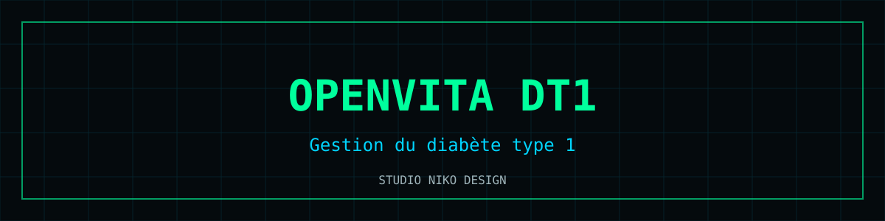
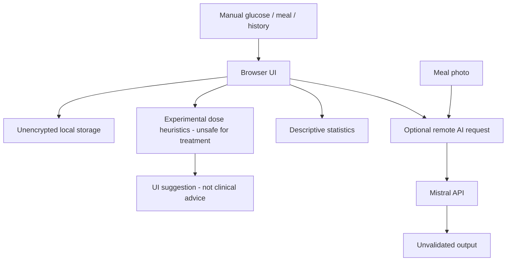

# OpenVita DT1 Pro — Studio Niko Design

**Experimental type 1 diabetes software research prototype — not a treatment decision tool.**

Un prototype de recherche sur les interfaces de journal glycémique, les calculs insulinés expérimentaux et la vision alimentaire. Ne pas l'utiliser pour décider d'un traitement.

  

**STUDIO NIKO DESIGN** · Build smart. Stay lightweight. Create without limits.

[Démo existante (disponibilité non vérifiée)](https://nikoju1977.github.io/OPENVITA-DT1/) · [English overview](#english-overview) · [Quickstart](#quickstart--démarrage-rapide)

> Démonstration et qualification : données fictives uniquement. Aucun GIF ni résultat de test n'est revendiqué.

> **Prototype non validé cliniquement.** Ne pas utiliser pour une décision médicale, un diagnostic, une prescription ou une urgence. En France, danger immédiat : 15 ou 112. Inspection statique de sources uniquement ; aucun nouveau test, audit de sécurité, appel réel fournisseur, essai sur appareil ou validation clinique n'a été réalisé pour ce README.

## Pourquoi ce projet ?

Étudier une interface de suivi et les limites des algorithmes de calcul, sans présenter les sorties comme des recommandations thérapeutiques validées. L'objectif d'ingénierie prioritaire est la maîtrise des risques, la validation des unités et la séparation entre journal descriptif et décisions médicales.

## Fonctionnalités clés

- 📓 Saisie manuelle de glycémie, historique et statistiques descriptives.
- 🧪 Calculs expérimentaux de correction, estimation de l'insuline active et paramètres suggérés : présents, non validés et à désactiver avant toute utilisation réelle.
- 🧠 Appels Mistral pour le dialogue et l'analyse de l'historique.
- 📷 Analyse d'image alimentaire via modèle distant ; estimation non fiable pour le calcul d'insuline.
- 📂 Stockage navigateur et fonctions d'import/export ; interface vocale et tentative de cache PWA.

## Architecture & algorithmes

### Analyse des algorithmes et risques cliniques

| Fonction dans `index.html` | Constat |
| --- | --- |
| `getIOB` | Décroissance linéaire des bolus consignés pendant la DIA ; ni courbe pharmacodynamique validée, ni acquisition exhaustive des injections. |
| `estimateTDD`, `maxBolus`, `refreshCalcSuggest`, `applyCalcSuggest` | Heuristiques fondées sur poids/âge pour estimer dose journalière et paramètres de traitement ; présence de valeurs par défaut et de variantes pédiatriques. Aucune validation clinique. |
| `promptBG`, `trigHypo` | Messages de correction et d'hypoglycémie à partir de seuils ; une action de journalisation n'est pas une preuve d'injection. Un minuteur navigateur ne garantit pas une alarme. |
| `runAIBilan`, `analyzePlate` | Analyse générative distante d'historique et estimation alimentaire par image ; erreurs et suggestions médicales possibles. |

**Risque majeur :** les sorties peuvent être dangereuses si utilisées pour une injection, particulièrement en pédiatrie. L'IOB dépend d'un historique incomplet ou erroné et n'est pas un modèle validé. Le code utilise principalement mg/dL, contrairement à l'ancienne présentation en g/L : toute conversion doit être explicitement validée. Les suggestions ne doivent pas être utilisées, même à titre indicatif, pour déterminer ou modifier un traitement. Ne pas utiliser avec des données de patients ni comme alarme ou outil de décision de santé.

**Périmètre non démontré :** les mentions Nightscout/CGM, oref1/SMB, AGP et CIQUAL dans l'ancienne description ou les métadonnées ne prouvent pas leur implémentation. L'inspection de l'application principale n'a pas retrouvé de client Nightscout opérationnel, de moteur oref1/SMB complet ou de rapport AGP conforme. Aucune connexion pompe, boucle fermée, acquisition CGM temps réel ou conformité clinique ADA/EASD/ISPAD n'est revendiquée.

## Confidentialité et sécurité

- Le stockage actif `safeStorage` utilise `localStorage` avec repli mémoire ; ni le profil patient, ni les historiques, ni la clé API enregistrée ne sont chiffrés par cette façade. Le commentaire AES-GCM ne décrit pas le mécanisme actif.
- `callAI` construit des messages susceptibles de contenir prénom, âge, poids, paramètres thérapeutiques, IOB et historique de conversation. `runAIBilan` transmet des observations de glycémie, repas et bolus ; `analyzePlate` transmet une photographie encodée au fournisseur Mistral. Il ne s'agit donc pas d'une application strictement locale.
- Les données de santé, images et identifiants nécessitent une gouvernance et un consentement appropriés, une analyse réglementaire et la qualification des fournisseurs avant tout usage réel. Ne pas saisir de données médicales ou de secrets dans cette version de démonstration.
- Chart.js 4.4.3 et ressources externes, services vocaux selon navigateur ; le service worker et l'installation PWA n'ont pas été validés. Un examen des flux et de la sécurité du rendu des contenus est nécessaire.

## Cadre médical et réglementaire

Les références à la qualité des dispositifs médicaux (ISO 13485), au cycle de vie logiciel (IEC 62304), à la gestion des risques (ISO 14971) ou à la protection des données (RGPD) sont des pistes de qualification selon l'usage prévu, et non des déclarations de conformité. L'applicabilité réglementaire doit être évaluée par des spécialistes. Aucune validation clinique, certification, autorisation de mise sur le marché ni conformité à FDA 21 CFR Part 11 n'est démontrée.

## Quickstart / Démarrage rapide

Pour examiner l'interface sans usage clinique, servir le dépôt avec `python3 -m http.server 8000` puis ouvrir http://localhost:8000/. Utiliser uniquement des données fictives ; ne pas configurer de clé réelle ni envoyer de photo privée. Ne pas suivre les suggestions de dose affichées par l'interface.

## Sécurité clinique — conditions préalables à toute qualification

> **Priorité critique : neutraliser les suggestions de dose et de paramètres thérapeutiques.** Le projet contient encore des calculs et propositions non validés, y compris pour des profils pédiatriques. Les utiliser pour une injection ou une modification du traitement peut être dangereux. Cette révision documentaire n'en désactive pas le code.

| Contrôle proposé (non exécuté) | Critère de sécurité attendu |
| --- | --- |
| Journal descriptif | Restituer fidèlement des observations fictives, avec unité et provenance explicites |
| Données incomplètes | Signaler l'indisponibilité ; ne produire aucune suggestion thérapeutique |
| Unités incompatibles | Bloquer les interprétations ambiguës ; vérifier les libellés et conversions sans calcul de dose |
| Historique d'injections | Distinguer une observation déclarée d'une administration confirmée ; aucune action thérapeutique automatique |
| Analyse IA / photo | Empêcher l'utilisation des réponses génératives comme base d'un traitement ; aucune photo privée ni clé réelle lors des essais |
| Confidentialité | Séparer identifiants, données de santé et secrets ; qualifier le stockage et les transferts avant toute utilisation réelle |

Le journal seul ne constitue ni une surveillance glycémique continue ni une alarme médicale. Les mentions de Nightscout et oref1 dans les métadonnées HTML ne prouvent pas leur disponibilité. Les critères ci-dessus sont des objectifs de réduction de risque, pas des résultats de tests ou une autorisation d'usage clinique.

**English:** Disable all unvalidated treatment suggestions before considering real-world use. Keep synthetic descriptive records separate from therapeutic decisions, verify units and data provenance, and prevent AI outputs from informing insulin administration. No clinical, security or runtime validation was performed here.

## Roadmap & contribution

Propositions non terminées :

- [ ] Priorité sécurité : neutraliser les recommandations de dose, paramètres automatiques et actions ambiguës tant qu'elles ne sont pas qualifiées ; conserver uniquement un journal descriptif.
- [ ] Supprimer les affirmations de fonctionnalités CGM/oref1/AGP non démontrées dans l'interface et les métadonnées.
- [ ] Mettre en place coffre chiffré, séparation des secrets et consentement granulaire avant tout transfert ; examiner le rendu de contenu et les dépendances.
- [ ] Valider les unités et les entrées sur cas synthétiques, puis établir une démarche indépendante de validation clinique et réglementaire si un usage médical est envisagé.

**Première contribution / `good first issue` (label proposé, non créé ici) :** Documenter un scénario de confusion d'unités avec valeurs synthétiques et résultat attendu de blocage, sans calcul de dose utilisable.

Les contributions ciblées sous MIT sont bienvenues. [Issues](https://github.com/Nikoju1977/OPENVITA-DT1/issues) pour les sujets non sensibles. Ne jamais publier de données de santé, de captures personnelles, de clés API ou de détails exploitables de vulnérabilité. Contacter le mainteneur en privé pour les problèmes de sécurité.

## English overview

OpenVita DT1 Pro is a research prototype with manual glucose entries, descriptive statistics, unvalidated insulin-related heuristics and remote Mistral chat/meal-image analysis. Do not use it for insulin dosing, treatment adjustment, emergency monitoring or patient care. Its simplified IOB and suggested treatment parameters are not clinically validated, including pediatric paths. Patient records and API credentials are stored without application-level encryption; remote requests may include health information and images. No operational Nightscout/CGM, complete oref1/SMB engine or standardized AGP report was established in the inspected main HTML. The main glucose unit observed is mg/dL. Use synthetic data only.

No new runtime, security or clinical validation was performed in this documentation revision.

## Licence & auteur / License & author

[MIT](LICENSE) © 2026 Nicolas Julienne — Studio Niko Design. Les droits et mentions des dépendances tierces restent applicables. Contributions sous la licence existante. Aucun fichier de licence n'a été modifié.

[Studio Niko Design — Portfolio](https://github.com/Nikoju1977)
