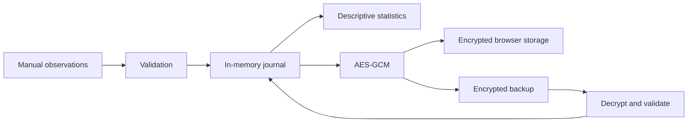

# OpenVita DT1 — Studio Niko Design

**Local encrypted descriptive journal — not a clinical decision tool.**

[Application](https://nikoju1977.github.io/OPENVITA-DT1/) (publication de cette révision non vérifiée).

## Fonctions implémentées — 25 novembre 2026

- Coffre persistant sous une clé de stockage propre à l'application, AES-GCM 256 et PBKDF2 SHA-256 (600 000 itérations), sel et IV aléatoires ; phrase secrète non enregistrée.
- Saisie, modification, suppression, filtrage des observations de glycémie (unités explicites), des glucides déclarés et des notes.
- Statistiques descriptives (minimum, maximum, moyenne arithmétique) par unité, sans mélanger les séries. Graphique des 60 derniers relevés sélectionnés, espacement par ordre de relevé et non par durée.
- Export du coffre chiffré et restauration d'un autre coffre avec sa phrase secrète, après validation et confirmation.
- Import volontaire des glycémies numériques de l'ancien journal, marquées historiques non vérifiées ; aucune migration de conseils, clé API, profil ou dose.
- Verrouillage manuel, détection des écritures sur une version obsolète du coffre (pas une garantie de transaction multi-onglets), confirmation avant suppression.
- Guide intégré et identité visuelle conservés ; interface métier réorganisée autour du journal. Aucun chargement de modèle distant, ni fournisseur IA, ni bibliothèque graphique externe dans l'entrée HTML actuelle.

## Limites et sécurité

Le code antérieur de suggestions de dose, IOB expérimental, estimations alimentaires par image, profil thérapeutique, IA distante et alertes automatisées n'est plus exécuté. Il reste dans l'historique Git. Aucune intégration CGM, Nightscout, oref1, commande de pompe ou alarme médicale n'est établie. Une future réintégration nécessite une qualification spécifique et indépendante.

Les anciennes données en clair et clés API ne sont ni chargées automatiquement ni effacées automatiquement. Le coffre actuel est chiffré au repos, mais son contenu est accessible à la page lorsqu'il est ouvert ; il ne protège pas contre un navigateur, une origine ou un appareil compromis. Une phrase secrète oubliée ne peut pas être récupérée. Conserver des sauvegardes externes. HTTPS ou localhost requis. Aucun usage médical, diagnostic ou traitement ; données fictives exclusivement pendant la qualification.

## Preuves et qualification

- [Code journal](https://github.com/Nikoju1977/OPENVITA-DT1/commit/536ca5fa3eca91463bfb29fcf1f8659d920375c7) : 14 assertions JavaScript de validation et statistiques réussies pendant la rédaction.
- [Restauration portable et contrôle de version](https://github.com/Nikoju1977/OPENVITA-DT1/commit/45c7c00fe8e0567ce5bca165896cb2dffecfc2a6) : source relue après publication.
- Tests navigateur, cryptographie bout en bout, sauvegarde/restauration sur appareils distincts, comportement multi-onglets, accessibilité, cache PWA et déploiement restent à réaliser. Aucun essai clinique ni conformité réglementaire revendiqués.

## English overview

OpenVita is a descriptive local journal with an encrypted persistent vault, manual observations, unit-specific statistics, and encrypted backup/restore code. It does not calculate insulin doses, interpret clinical data, or connect to medical devices. Fourteen data-validation and statistics assertions passed; runtime, security, clinical and deployment verification remain outstanding.

[MIT license](LICENSE) — unchanged. [Studio Niko Design](https://github.com/Nikoju1977).
